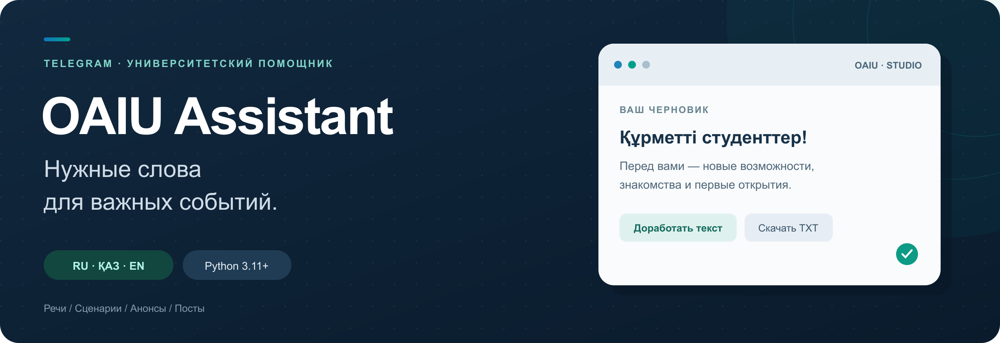
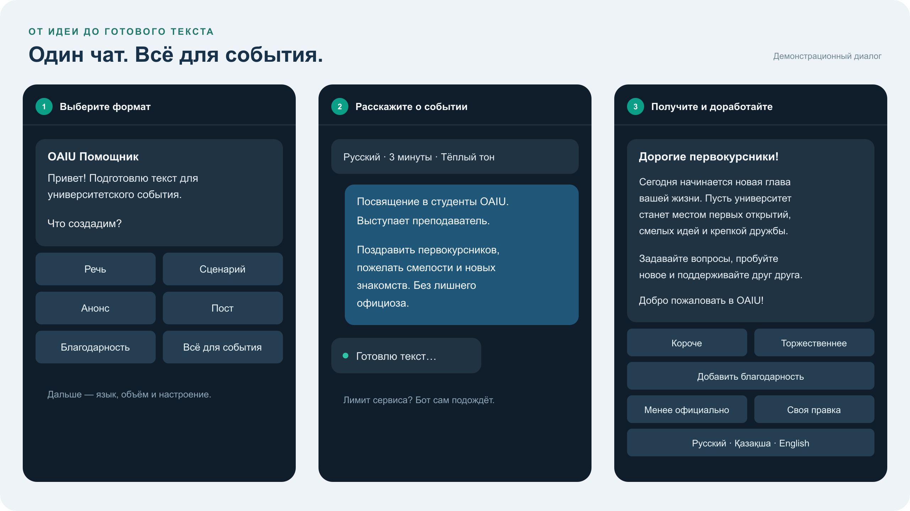

<p align="center">
  
</p>

<p align="center">
  <a href="https://github.com/Dansho09/oaiu-telegram-bot/actions/workflows/tests.yml"></a>
  
  
  
  
  
</p>

# OAIU Assistant

**Telegram-помощник для подготовки речей, сценариев и текстов университетских мероприятий.** Выберите формат, язык и настроение, расскажите о событии — и получите черновик, который можно доработать прямо в чате.

*Университеттегі іс-шараларға арналған сөздер, сценарийлер мен мәтіндерді дайындауға көмектесетін Telegram-бот.*

<p align="center">
  <a href="#возможности">Возможности</a> ·
  <a href="#как-это-работает">Пример работы</a> ·
  <a href="#быстрый-запуск">Быстрый запуск</a> ·
  <a href="#проверка">Проверка</a>
</p>

## Возможности

| Задача | Что подготовит бот |
| --- | --- |
| 🎤 Речь | Приветствие, поздравление или выступление с учётом аудитории и длительности |
| 🎭 Сценарий | Программа на 15 минут – 8 часов, реплики 1–4 ведущих, точный тайминг и направления выходов (Cloudflare) |
| 📣 Анонс | Приглашение или объявление о событии |
| 📱 Пост | Текст для социальных сетей |
| 💐 Благодарность | Тёплое обращение к участникам и организаторам |
| 📦 Комплект | Речь, сценарий, анонс и пост для одного мероприятия |

В рабочей Cloudflare-версии **все кнопки интерфейса на казахском**, а язык готового текста выбирается отдельно: **қазақша, русский или English**. После ответа можно сократить текст, изменить тон, добавить благодарность, перевести или написать свою правку обычным сообщением.

Бот сохраняет последние версии и выгружает результат в **Word, PDF и TXT**. Word остаётся редактируемым; PDF содержит встроенный шрифт с русскими и казахскими буквами. При временном лимите Groq бот сохраняет задачу, ждёт в фоне и отправляет готовый результат.

В рабочей **Cloudflare-версии** доступны:

- **Конструктор программы** — от 1 до 16 блоков: добавить, удалить, переставить и изменить длительность. Общая программа занимает от 15 минут до 8 часов.
- **Отдельные листы** — реплики каждого ведущего, лист для звука и координатора с таймингом. Файлы получает автор сценария и может переслать команде.
- **Проверка перед выступлением** — поиск явных пропусков: незаполненные поля, дата, площадка, время начала и имена ведущих. Это вспомогательная проверка, а не подтверждение фактов.
- **Справочник OAIU** — ректор, проректоры, деканы и заведующие кафедрами через `/people`; выбранные ФИО и должности включаются в задание.
- **Панель владельца** — импорт Word `.docx` до 1 МБ: предварительный просмотр изменений справочника или структуры образца, затем отдельное подтверждение публикации. Обычным пользователям админка недоступна.

Подробности — в [инструкции Cloudflare](cloudflare/README.md). **Python-вариант — прежняя базовая версия**: тексты, правки, переводы, TXT и история; новые функции программы и документов реализованы в Cloudflare.

## Как это работает



*Иллюстрация интерфейса с демонстрационным текстом. Реальные переписки пользователей в репозиторий не включены.*

1. Выберите формат речи, русский язык результата, 3 минуты и тёплый тон. Кнопки рабочего бота подписаны на казахском.
2. Опишите событие, например:

   > Посвящение в студенты OAIU. Выступает преподаватель. Поздравить первокурсников, пожелать смелости и новых знакомств. Без лишнего официоза.

3. Получите текст и нажмите нужную кнопку или напишите: «Добавь благодарность преподавателям».
4. Сохраните результат командой `/word`, `/pdf` или `/txt`. Для сценария откройте `/program`, `/sheets` и `/check`.

Попробовать бота: [@OAIUHELPbot](https://t.me/OAIUHELPbot). Откройте чат и нажмите «Старт» — приглашение не требуется. Для своего экземпляра создайте бота по инструкции ниже.

## Быстрый запуск

Для размещения без постоянно включённого компьютера используйте [Cloudflare-версию и инструкцию переноса](cloudflare/README.md). Ниже описан альтернативный локальный запуск на Python.

Нужны **Python 3.11+**, токен от [BotFather](https://t.me/BotFather) и [API-ключ Groq](https://console.groq.com/keys). Дополнительные Python-библиотеки устанавливать не нужно.

```bash
git clone https://github.com/Dansho09/oaiu-telegram-bot.git
cd oaiu-telegram-bot
python3 setup.py
python3 bot.py
```

`setup.py` проверит подключение и попросит ввести ключи. Ввод скрыт; настройки сохраняются локально в `.env`. Откройте ссылку из созданного `private-invite.txt`, чтобы получить доступ к своему боту.

На macOS также можно запускать **`start.command`** двойным щелчком. Для остановки используйте **Ctrl+C**.

### Работа без ноутбука

Для **Cloudflare Workers Free** подготовлена [полная версия бота](cloudflare/README.md): защищённый webhook, SQLite-backed Durable Object для истории и очередь с фоновыми повторами. Постоянно включённый сервер и ручное продление раз в 4 дня не нужны; действуют бесплатные квоты Cloudflare и отдельные лимиты Groq. Доступны казахские кнопки, три языка текстов, конструктор программы, листы участников, Word/PDF/TXT, правки и история. Инструкция включает приватный перенос SQLite и переключение Telegram без удаления ожидающих сообщений.

В [инструкции по размещению](DEPLOYMENT.md) также описаны Python-хостинги, включая Bot-Hosting.net Free с ручным продлением раз в 4 дня. Для контейнерного запуска подготовлены **Dockerfile** и **railway.json**. Для Python-версии историю и очередь нужно хранить на постоянном диске.

### Настройки

Пример полей находится в [`.env.example`](.env.example).

| Переменная | Назначение |
| --- | --- |
| `TELEGRAM_BOT_TOKEN` | Токен Telegram-бота |
| `GROQ_API_KEY` | Ключ сервиса генерации |
| `GROQ_MODEL` | Модель; по умолчанию `qwen/qwen3.8-27b` |
| `BOT_ACCESS_CODE` | Код приглашения, который создаёт настройщик |
| `OAIU_DATA_DIR` | Необязательный путь к папке с базой SQLite |

Для добавления или замены ключа Groq:

```bash
python3 setup.py --groq-only
```

Работающий бот подхватит ключ при следующем запросе. Ключи, ссылки приглашения и база переписки исключены из Git через `.gitignore`.

## Команды

| Команда | Действие |
| --- | --- |
| `/start` | Начать работу |
| `/new` | Создать новую задачу |
| `/history` | Открыть последние черновики |
| `/cancel` | Отменить ожидающую задачу |
| `/help` | Показать помощь |
| `/privacy` | Узнать, как обрабатываются данные |
| `/delete` | Удалить свои тексты из базы бота с подтверждением |
| `/people` | Руководство и кафедры — Cloudflare |
| `/word`, `/pdf`, `/txt` | Скачать готовый текст — Cloudflare |
| `/program` | Настроить блоки программы — Cloudflare |
| `/sheets` | Листы ведущих, звука и координатора — Cloudflare |
| `/check` | Найти явные пропуски перед выступлением — Cloudflare |

## Устройство проекта

```text
Telegram → Cloudflare webhook → Durable Object → Groq → текст в Telegram
                                     ↕
                               SQLite + Alarms
                         задача · очередь · история

Альтернативный запуск: Telegram long polling → Python bot → Groq
```

- **Cloudflare / JavaScript** — webhook, постоянная SQLite, очередь и восстановление через Alarms. Повторные update не обрабатываются дважды; готовый ответ хранится до доставки. Для DOCX и PDF используются `fflate`, `pdf-lib` и `@pdf-lib/fontkit`; зависимости зафиксированы в lockfile. Документы создаются внутри Worker без внешнего конвертера.
- **Python / asyncio** — альтернативный запуск с long polling. Генерация выполняется по одному запросу, сетевые операции используют не более четырёх потоков. Проверенный TLS-контекст повторно используется, а временные блокировки чатов освобождаются после завершения обработчиков.
- **Telegram Bot API** — сообщения, кнопки и выгрузка файла; webhook в Cloudflare или long polling в Python-версии.
- **Groq** — генерация и редактирование текстов.
- **SQLite** — сохранение задачи, до 10 последних версий текста и очереди ожидания.
- **Стандартная библиотека Python** — без внешних runtime-зависимостей.

```text
├── bot.py                   # Диалог, генерация, очередь и хранение
├── setup.py                 # Настройка и проверка ключей
├── start.command            # Запуск на macOS
├── .env.example             # Пример конфигурации без секретов
├── Dockerfile               # Контейнер для сервера
├── railway.json             # Запуск и перезапуск в Railway
├── DEPLOYMENT.md            # Работа без ноутбука и перенос данных
├── cloudflare/              # Полный бот на Workers, история и приватный перенос
├── tests/test_bot.py         # Автоматические проверки
├── assets/                  # Обложка, демонстрация и аватар
└── .github/workflows/        # Проверки в GitHub Actions
```

## Проверка

Рабочая Cloudflare-версия требует Node.js 24 и pnpm 11.25.0:

```bash
cd cloudflare
pnpm install --frozen-lockfile --ignore-scripts
pnpm test
pnpm run check
```

Автоматические проверки охватывают webhook и секреты, диалог, изоляцию пользователей, очередь и отмену, историю, Word/PDF и казахские символы, точный тайминг, конструктор программы, роли ведущих, справочник, права владельца и импорт DOCX с подтверждением. `pnpm run check` проверяет сборку Worker без публикации.

Проверки альтернативной Python-версии запускаются из корня:

```bash
python3 -m unittest discover -s tests -v
```

Тесты не обращаются к Telegram или Groq и не требуют настоящих ключей. GitHub Actions запускает Node.js 24 и Python 3.11, 3.12, 3.13 и 3.14.

## Работа и данные

Бот отвечает в личных чатах. Cloudflare-версия получает сообщения через webhook и работает без включённого ноутбука в пределах доступности и квот провайдеров. Python-версия требует постоянно запущенного процесса на компьютере или сервере. Для одного токена выбирают одно подключение: webhook либо один poller.

Описание события и текущий текст передаются в Groq для генерации; Telegram ID в запрос модели не включается. Текущая задача, история и очередь хранятся в приватной SQLite: в Cloudflare Durable Object либо на диске Python-сервера. `/delete` удаляет записи из базы бота, но не переписку у Telegram и данные у провайдера. Ключи и пользовательские базы в публичный репозиторий не входят. Импортированные владельцем образцы сохраняют только распознанную структуру блоков, без исходных реплик и имён участников; хранятся пять последних утверждённых образцов. Профессиональные ФИО и должности из справочника становятся общими только после подтверждения владельцем.

Квоты провайдера могут увеличить время ожидания. Бот автоматически повторяет запрос после временного лимита; ошибочный ключ или неверные настройки требуют исправления владельцем. Перед выступлением стоит проверить имена, даты и формулировки.

---

<p align="center">
  <br>
  <strong>OAIU Assistant</strong><br>
  Для университетской жизни. Для ваших слов.
</p>
